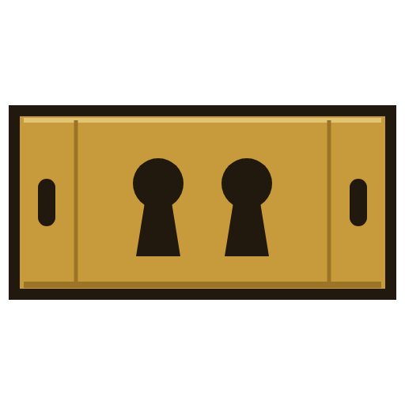
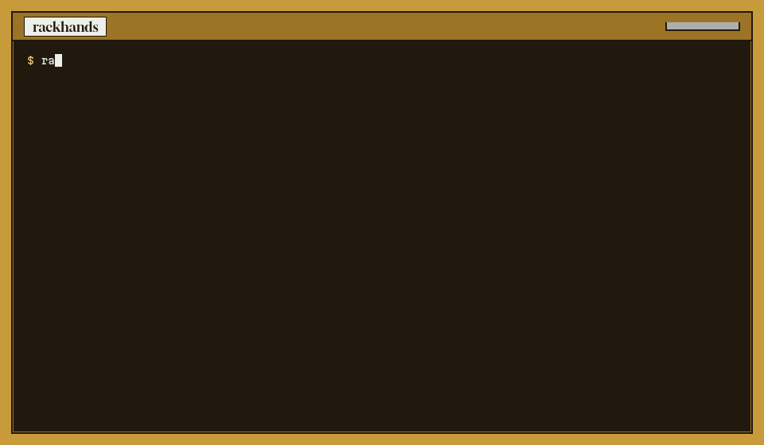

<p align="center"></p>

# rackhands

**Remote hands for your racks, for you and your AI agent.** One binary that reads and operates server BMCs across vendors. Redfish on Dell iDRAC, HPE iLO, Lenovo XCC, Supermicro and any DMTF-conformant BMC, with IPMI as the fallback. Nothing that can take a machine down runs until you allow it and confirm it.

Every vendor speaks its own Redfish dialect. The hardware log is `Sel` on iDRAC, `IML` on iLO, `PlatformLog` on XCC and `Log1` on Supermicro. The health rollup hides in a different OEM block on each, and each one accepts a different set of reset types. Older and cheaper boxes speak only IPMI. The existing Redfish MCP servers either cover one vendor, or give an agent `set_power_state` with nothing in between. rackhands normalises the reads and puts every dangerous operation behind two keys, a plan and a confirmation.



Landing page: https://blackman99.github.io/rackhands/ · Docs: https://blackman99.github.io/rackhands/docs/

## Install

```bash
go install github.com/Blackman99/rackhands/cmd/rackhands@latest
```

Or download a single static binary for linux / macOS / windows from [Releases](https://github.com/Blackman99/rackhands/releases).

## Usage

```console
$ rackhands health
CRITICAL  db-01  (Dell, via redfish)
   Critical  subsystem power supplies  — iDRAC rollup
   Critical  psu PS2 Status  — reading 0 W
CRITICAL  web-07  (HPE, via redfish)
   Critical  fan Fan 3  — reading 0 %
OK        k8s-12  (Lenovo, via redfish)
WARNING   lab-x10  (Supermicro, via ipmi (fallback))
   Warning   temperature PSU2 Temp  — reading 117 C
$ rackhands events web-07 --min critical      # iLO IML, same shape as the iDRAC SEL
$ rackhands power db-01 force-off
rackhands: operation not allowed: "power" is off; start with --allow power (dangerous operations are disabled by default)
```

Targets live in `~/.config/rackhands/targets.yaml` ([example](examples/targets.yaml)). Use `--host https://bmc --user root` for a one-off.

**Dangerous operations** (`power`, `boot`, `bmc-reset`, `firmware`, `virtual-media`) need all of the following:
- `--allow CLASS` when you start rackhands.
- `allow: [CLASS]` on that target in the config.
- Exactly one named target.
- A confirmation: you type the target name, or pass `--yes <name>`. Over MCP it is a single-use token, bound to the exact request, that the agent only gets back after it shows you the plan.

Every plan and execution is appended to an audit log. `--dry-run` shows the exact request and stops.

**For agents:** `rackhands mcp` is an MCP server on stdio. It is read-only by default. Dangerous tools are not even listed unless their class is allowed.

```json
{"mcpServers": {"rackhands": {"command": "rackhands", "args": ["mcp"], "env": {"BMC_PASSWORD": "…"}}}}
```

CI runs the binary against the [DMTF Redfish-Mockup-Server](https://github.com/DMTF/Redfish-Mockup-Server), serving the DMTF mockup plus Dell, HPE, Lenovo and Supermicro mockups, and against OpenIPMI `ipmi_sim` ([test/integration.sh](test/integration.sh)).

See [GOAL.md](GOAL.md), [ROADMAP.md](ROADMAP.md), [CONTRIBUTING.md](CONTRIBUTING.md). MIT licensed.
